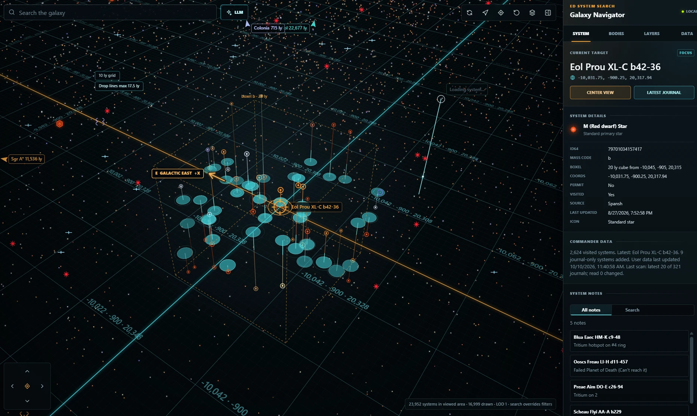
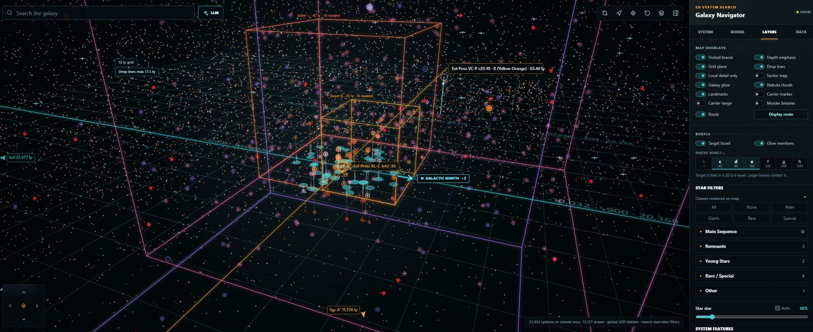

# Elite Dangerous System Search

A local desktop web application for exploring the Elite Dangerous galaxy. It
turns Spansh system dumps into compact local indexes, renders the galaxy as an
interactive 3D map, and enriches it with player journals, full body and station
records, notes, points of interest, and exploration overlays.

The application runs entirely on your computer. Generated databases, journal
history, and notes stay under `data/` and are excluded from Git.

## Interface

The map starts with nearby, full-resolution systems so the current area is
usable while the sampled whole-galaxy layer loads in the background. The Layers
tab includes **Local detail only**, which intentionally keeps that clearer local
view by hiding the global LOD layer. It is useful when dense local exploration
patterns are more useful than galaxy-wide context, and the preference persists
between sessions.

| Local detail only | Full galaxy detail |
| --- | --- |
|  |  |
| Detailed systems near the current view, with the global LOD layer hidden. | Sampled galaxy-wide context, merged with the local detailed sphere. |

Close up, the map borrows the in-game galaxy map's visual language. The
selected system gets a focus ellipse and an outline of its ID64 **boxel**, the
octree cell the game files it in, and the System panel lists its mass code and
boxel bounds. Stars stand on stalks that end in flat footprint discs on the grid
plane, coordinate labels lie on the grid itself, and **GALACTIC NORTH +Z** /
**GALACTIC EAST +X** plates plus bearing tags for Sol, Sagittarius A*, and
Colonia keep you oriented at any zoom.



## Highlights

- Interactive 3D galaxy map with orbit, pan, vertical movement, rotation,
  adaptive grids, distance guides, focus controls, and landmark bearings.
- Full-resolution local spatial detail merged with the sampled global LOD,
  loaded first so the current area is responsive while galaxy-wide context
  arrives in the background.
- Mass-layered galaxy LODs: like the in-game map, wide views favour heavy
  systems (O and B stars, Wolf-Rayet stars, black holes) using the mass code
  in each system's ID64, over a glow drawn from known-system density.
- Galaxy-map styling borrowed from the in-game map: stalks ending in flat
  footprint discs, coordinate labels lying on the grid plane, a focus ellipse,
  eased camera glides between targets, soft nebula clouds, and a route strip
  (current system, next jump, jumps left, destination).
- **Boxel outlines** for the selected system and, optionally, the larger parent
  boxels that contain it, each in its own colour. **Glow members** lights up
  the systems filed in each shown boxel. The System panel lists the mass code
  and boxel bounds.
- Galactic direction cues on the grid (**GALACTIC NORTH +Z**, **GALACTIC EAST
  +X**), an optional Elite-style **Sector map** of region lines at galaxy
  scale, and drop-line anchors that pulse gently on the grid plane.
- **Colour stars by** economy, security, or government, with a legend whose
  toggles drive the matching System features filter; visited braces stay on
  top of any colour mode.
- Persistent **Local detail only** mode to hide the global LOD layer and retain
  the clear, exploration-pattern-focused nearby view on purpose.
- Fast fuzzy system search with suggestions and filter-overriding results.
- Star colors and sprites based on primary-star class, including distinct
  treatment for black holes, neutron stars, white dwarfs, protostars, giants,
  and supergiants.
- Automatic star-marker scaling from a clear local view to an uncluttered
  whole-galaxy view, plus a manual scale control.
- Optional grid-relative depth emphasis that brightens grounded stars, fades
  off-plane context, strengthens drop-line footprints, and animates hovered
  depth guides.
- Persistent visited-system braces, latest-journal focus, and incremental or
  full journal rescans with a determinate progress bar.
- **Live journal following**: while you play, your position, scans, bio
  signals and organic scans show up within a second or two, and are saved a few
  seconds after each burst of activity. No refresh button needed. **Follow
  journals live** is under Data > Journal import. **Auto targeting** (the
  crosshair next to the Live pill, or the same option under Data) moves the
  target to each new system you jump to; off, the journal is still followed
  but the target stays where you put it.
- **High-value exobiology**: a boxel map of the expected value of 10M+ credit
  species, and per-body species predictions in the Bodies tab (see
  [High-value exobiology](#high-value-exobiology)).
- Fleet carrier tracking set up from the app: enter your carrier's name or
  callsign and its ID is found in your journals. The carrier marker and its
  500 ly jump-range bubble each have their own toggle.
- Current ship summary from journals, including a per-ship manual maximum-jump
  override that remains separate from the recorded Loadout value.
- Optional live route overlay from Elite's `NavRoute.json`, refreshed about
  every five seconds while the app is visible and resilient to temporary file
  writes.
- Journal-only systems and discovered body data are preserved even when the
  system is absent from the current Spansh dataset.
- Per-system notes with tooltip display, an all-notes view, and keyword search.
- EDAstro POIs and discovery overlays for nebulae, carriers, stellar features,
  stations, sightseeing locations, AA-A h sectors, rare valuable worlds, and
  Explorarium categories.
- Optional full-galaxy records for bodies, stations, economies, security,
  government, atmospheres, volcanism, rings, signals, and other system details.
- Rich map filters for stations, population, body counts, body types,
  atmospheres, ring materials, volcanism, economies, security, and government.
- **Smart search**: describe what you want ("earth-like worlds within 300 ly",
  "icy rings with tritium") and it searches the systems nearest your target,
  showing as you type what it understood. No setup is needed. An optional AI
  assistant (Claude, ChatGPT, or a local KoboldCPP server) handles wording the
  built-in search does not recognise; its keys are kept in the operating
  system's credential store, never in the browser.
- Default-off **Murder Binaries** caution overlay for systems with a secondary
  star between 5 and 12 light-seconds from arrival.
- In-app controls for system deltas, full-data imports, places, discoveries,
  journals, and long-running update progress.
- Crash-safe imports: full imports only replace live data once the whole
  source has been read, and stranded temp files are cleaned up automatically.

## Boxels

Every procedurally named system is filed in a boxel, a cube in one of eight
nested grids. Its mass code (the letter before the last number, as in the `b`
of `Eol Prou XL-C b42-36`) sets the cube size, from 10 ly for `a` to 1,280 ly
for `h`. The boxel code (`XL-C` plus `42`) says which cube it is. A 40 ly `c`
boxel holds eight 20 ly `b` boxels, and so on up the scale. That is why
systems with different name codes share space: an `Eol Prou WC-P c20` system
can sit inside the 20 ly cube of `Eol Prou XL-C b42`, because it is filed in
the 40 ly `c` boxel around it.



The **Boxels** section of the Layers tab controls these outlines:

| Control | Default | Shows |
| --- | --- | --- |
| Target boxel | On | The selected system's own boxel |
| Parent boxels (`b` to `h`) | Off | The larger boxels containing the target's boxel. Sizes at or below the target's own mass code are disabled. |
| Glow members | Off | Makes each shown outline glow, along with the systems filed in that boxel (same mass code, same cube). Hidden boxels get no glow. |

Each mass code has its own colour, and each outline's label gives the number of
member systems currently loaded. Large parent boxels can extend beyond the
loaded detail area, so that count may be lower than the full total.

## High-value exobiology

The **High-value bio** section of the Layers tab colours boxels by how much
high-value exobiology a scanned system there tends to hold. It covers 18
species worth about 8 to 19 million credits each, such as Stratum Tectonicas,
Tussock Stigmasis, Fonticulua Segmentatus and Concha Biconcavis, and you can
narrow it to any of them.

The galaxy dump only says which genus was found on a body, never the species,
so the species comes from the body's conditions:

1. **Hard rules** for each species (atmosphere, body type, gravity,
   temperature, pressure, volcanism, distance from arrival, galactic arm), from
   the EDMC-BioScan rulesets.
2. **Logged finds** per colour variant from Canonn Bioforge. Colour variants
   follow the local star class or a rare surface material, and their counts
   weight species that share the same conditions.
3. **Observed genus rates**: every DSS-mapped body in the galaxy dump that
   could hold a species says whether its genus was there. Per boxel, that rate
   is pulled toward the galaxy-wide rate when few bodies were mapped, and
   applied to the boxel's bodies that were never mapped.
4. **Fully scanned systems**: per-system values come from systems where every
   body the FSS counted has a record. In thinly explored areas the dump often
   holds just the bodies someone found worth scanning, which would make those
   areas look richer than they are.

Checked against the species analysed in the author's own journals, the right
species was allowed on 100% of high-value finds and ranked first on 97%. The
absolute chances run high, because players mostly DSS-map bodies that already
show bio signals, so read the map as a comparison between areas.

| Control | Shows |
| --- | --- |
| Bio value map | Each boxel column's expected base value per scanned system, ranked against all other columns (brighter is better); faint where few systems were fully scanned. It is drawn on the grid plane and moves up and down with it |
| Boxel size | 320, 640 or 1,280 ly columns |
| Heights | **All** averages every height in a column. **320** or **960 ly band** counts only the 320 ly layer at the map target's height (plus the layers above and below it for 960), and follows the grid plane as you move |
| Species | Which species count; **10M+** keeps those worth at least 10 million |

Selecting a system adds a **High-value bio** row to its details, with the
estimate for its 320 ly boxel (or its 1,280 ly sector when the boxel has too
little data) and the most likely species. The **Bodies** tab shows, for each
landable body with an atmosphere, which high-value species it could hold and
how likely each is: confirmed once you have scanned it, split by species once a
DSS scan has found the genus, otherwise estimated from its conditions.

Build the map once, and again after a large galaxy update, from
**Data > Build high-value bio map**, or with:

```powershell
npm run import:bio-targets
```

The first build downloads about 6 MB of Bioforge statistics into
`data/bioforge/`. The scan then reads the full-galaxy pack once and writes
`data/bio-targets.bin`. `npm run check:bio` compares the species model with
the organic scans in your journals.

## Requirements

- Windows 11
- A current Node.js LTS release
- Stable Rust toolchain with `cargo`
- Substantial free disk space for Elite Dangerous dump data

The source tree is small, but generated datasets are not. A complete rich
galaxy installation can require hundreds of gigabytes. At least 32 GB of RAM is
recommended for large imports; more memory improves the native import path.

## Quick Start

### 1. Clone and build

```powershell
git clone <repository-url>
cd <repository-folder>
npm run native:build
```

This project currently uses only Node.js built-in modules, so there are no npm
packages to install. The Rust build creates the high-throughput importer used
for large system and galaxy dumps.

### 2. Import the base system map

Download `systems.json.gz` from [Spansh Dumps](https://spansh.co.uk/dumps) and
place it in the project root, then run:

```powershell
npm run import:systems
npm run import:updates
npm run import:name-lookup
npm run import:suggestions
npm run import:spatial-index
```

These commands create the compact binary map, update-time index, exact-name
lookup, search suggestions, and a 100 ly-cell spatial index under `data/`. The
spatial index lets close views merge full local system detail with the sampled
whole-galaxy LOD, and the same step writes the galaxy glow image
(`galaxy-density.bin`). The downloaded dump can be deleted after a successful import.

### 3. Add optional overlays

```powershell
npm run import:places
npm run import:discoveries
npm run import:journals
```

Journal files are detected from the standard Windows location:

```text
%USERPROFILE%\Saved Games\Frontier Developments\Elite Dangerous
```

Set `EDSS_JOURNAL_DIR` before starting or importing to use another location.
Set `EDSS_DATA_DIR` to store generated data outside the project.

### Optional local carrier tracking

Carrier tracking shows your fleet carrier as a map landmark, keeps it in place
between sessions, and can draw its 500 ly jump-range bubble.

The easiest way to set it up is in the app: open **Data → Fleet carrier**, enter
the carrier's name or callsign, and choose **Save carrier**. The app looks up
the carrier ID, name, and callsign in your journals, saves them, and rescans so
the map follows the new carrier. The ID matters because the `CarrierLocation`
event the game writes at login contains only the ID. If it is not found yet,
open carrier management in game once and save again. **Layers → Carrier
marker** hides the marker and label without changing the setting.

The setting is stored in `config.local.json`, which is ignored by Git. You can
also write it by hand: copy `config.example.json` to `config.local.json` and fill
in `trackedCarrier`. `fallbackCoords` is optional and may be left as `null`. To
keep the file elsewhere, set `EDSS_CONFIG` to its path before importing journals
or starting the server.

### 4. Start the application

Double-click `Start ED System Search.bat`, or run:

```powershell
npm start
```

Open [http://localhost:5177](http://localhost:5177).

The server only listens on this computer (`127.0.0.1`) and only answers
requests addressed to `localhost`, `127.0.0.1`, or `[::1]`. To open it from
another device, set `EDSS_HOST` to the address to listen on (for example
`0.0.0.0`) and `EDSS_ALLOWED_HOSTS` to a comma-separated list of the hostnames
or IP addresses you will browse to. Traffic is plain HTTP, so do this only on a
network you trust.

### Smart search

The **Smart** button next to the search box opens a panel where you describe
what you are looking for in plain words. It searches the systems nearest your
current target using the full galaxy data, so that data must be installed. As
you type, a line under the box shows what will be searched for, such as
"icy rings · tritium · within 1,000 ly".

It understands these on its own, with no setup:

- **Body types:** earth-like worlds, water worlds, ammonia worlds, water giants,
  gas giants with water- or ammonia-based life, icy and rocky-ice bodies,
  high metal content and metal-rich bodies, terraformable bodies
- **Ring types:** icy, rocky, metal-rich, and metallic rings
- **Mining hotspots:** tritium, painite, platinum, low temperature diamonds,
  void opals, and the other ring materials
- **Signals:** biological and geological signals, or any signals
- **Distance and count:** "within 300 ly", "5 systems"
- **Required or preferred:** materials are required unless you say
  "preferably" or "ideally"; "painite or LTDs" accepts either

If the request contains words it does not recognise (for example "without",
or "neutron"), the preview says so before you search.

#### Optional AI assistant

You only need this for requests the built-in search does not recognise. Open
**AI assistant (optional)** in the panel, choose Claude, ChatGPT, or a local
KoboldCPP server, enter your API key (and a base URL only for a proxy or
compatible endpoint), and choose **Save key**. From then on, a request with
unrecognised words is read by the assistant, which also writes a short summary
of the results. Requests the built-in search fully understands never contact
it. If the assistant cannot be reached, the search still runs on the parts that
were understood. Using it sends the request text to that service and may be
charged to your account there.

Keys are stored by the local server in the operating system's credential store,
one entry per provider, and never kept in the browser:

| System | Store | Notes |
| --- | --- | --- |
| Windows | Credential Manager, under `ed-system-search/llm-<provider>` | Built in |
| macOS | Keychain, service `ed-system-search` | Built in (`security` tool) |
| Linux | Secret Service (GNOME Keyring, KWallet) | Needs `secret-tool` (package `libsecret-tools`) and a running keyring |

If no credential store is available, as on a headless Linux machine, keys fall
back to `data/llm-keys.local.json` in plain text, and the panel says so.

Each key is saved together with its base URL and is only ever sent there, so
changing the base URL means entering the key again. **Remove** deletes the
saved key. A key placed in `config.local.json` under `llmSearch.apiKey` is moved
into the credential store the next time the server starts, and keys saved in
the browser by older versions are moved the first time the page loads.

## Full Galaxy Details

The regular systems dump provides names, coordinates, primary-star classes, and
basic system metadata. Bodies, stations, factions, markets, and detailed
properties come from Spansh `galaxy.json.gz`.

After importing the base system map, place `galaxy.json.gz` in the project root
and run:

```powershell
npm run import:galaxy
```

Alternatively, stream the current dump directly:

```powershell
npm run import:galaxy:download
```

Rich records are stored separately under `data/galaxy/`, keeping ordinary map
navigation fast. See [Full Galaxy Data Storage](docs/GALAXY_DATA_STORAGE.md) for
the pack/index format, filtering sidecars, and delta behavior.

Once rich data is installed, build the Murder Binaries overlay with:

```powershell
npm run import:murder-binaries
```

The scanner reads the rich pack sequentially, performs minimal writes, and
creates a compact binary coordinate index plus a small metadata file. The map
queries only the nearest 50 warnings around the current view, so nearly a
million caution systems do not have to be sent to the browser. It does not
alter the rich database.

## Updating Data

The Data panel exposes the normal update workflows with progress and safeguards
for large downloads. Equivalent command-line updates are:

### Double-click updater

On Windows, double-click `Update ED System Search.cmd` in the project folder to
choose a system-map delta, rich-galaxy delta, journal refresh, or rebuild task.
It runs only the selected data-import command; it does **not** start the web
server. Choose **J** to import `galaxy.json.gz` already in the project folder,
or **K** to paste/drag any other local galaxy-dump path; neither option
downloads it again. Rich-data options build the native importer automatically
when needed. The full-galaxy download remains a separately confirmed choice
because it is a very large download.

After a completed full-galaxy import, option **N** (or `npm run repack:galaxy`)
performs a source-free, dictionary-compression repack of the rich base pack. It
does not download or parse `galaxy.json.gz` again, but it is long-running and
needs substantial temporary disk space. The updater requires typing `REPACK`
before it begins.

### Rebuild everything from one galaxy dump

`galaxy.json.gz` contains every system as well as its bodies, so it can replace
`systems.json.gz` as the source for the base map. With `galaxy.json.gz` in the
project root, choose updater option **O**, or run:

```powershell
npm run refresh:from-galaxy
```

This rebuilds the map, search indexes, spatial index, galaxy glow, rich data,
journals, and places index from that one download. The primary star comes from
each system's main-star body. Star types and permit flags the galaxy dump lacks
are carried over from your previous dataset by ID64. Full imports write to temp
files and only replace live data after the whole source has been read, so a
truncated download fails without damaging the existing map.

```powershell
npm run import:systems-delta:1day
npm run import:systems-delta:1week
npm run import:systems-delta:2weeks
npm run import:systems-delta:1month
npm run import:systems-delta:6months
npm run import:systems-delta:finish
```

To build the separate Green Gas Giant database from the installed full-galaxy
pack and the locally imported EDAstro POI list, run:

```powershell
npm run build:green-gas-giants
```

It writes `data/green-gas-giants.json`, retaining every known EDAstro GGG and
adding only strict very-high candidates: a Water Giant or Gas Giant with
Water-Based Life at 158 K. The resulting optional POI filters are `Green Gas
Giants` and `Green Gas Giant candidates`.

Rich-data deltas can be added without replacing the base pack:

```powershell
npm run import:galaxy-delta:1day
npm run import:galaxy-delta:7days
npm run import:galaxy-delta:1month
```

These commands also rebuild the map filter sidecars used by the System features
toggles. If you have already updated the normal system map and rich data, rebuild
only those sidecars with:

```powershell
npm run import:galaxy-filters
```

System-only updates preserve local journal systems and notes. Rich-data deltas
are searched newest-first when a system appears in multiple segments.

### Disk cleanup

The native importers, index builders, and server-managed JSON writers use temp
files that are renamed into place. If one of those operations is killed or
crashes it can strand `.tmp` files — a failed full-galaxy import can leave well
over 100 GB behind. The server clears these automatically at startup and after
each update, so no action is normally needed.

To run it by hand:

```powershell
npm run cleanup
```

Preview exactly what it would remove, without touching anything:

```powershell
npm run cleanup:dry-run
```

Cleanup only automatically removes `.tmp` files and directories under `data/`.
Live database files are never matched. Partial browser downloads
(`.crdownload`, `.part`, `.partial`, `.download`) in the project root are
reported but kept because they may be resumable. After confirming one is not
recoverable, opt in to removing aged partials with:

```powershell
node scripts/cleanup.js --include-partials
```

Cleanup is deferred while a known importer, index builder, or server-managed
atomic writer is active, and a temp file or directory is kept when it or any
descendant was modified within the last hour. Newly orphaned files are checked
again after that safety window.

Writers announce themselves with a lease file under `data/.active-imports`,
refreshed every 30 seconds while they run. Lease creation and destructive
cleanup also share `data/.cleanup-coordinator.lock`, so a writer cannot start in
the gap between cleanup's activity check and deletion. A stale lease is pruned
when its owner is no longer running. If a marker or coordinator lock's old PID
has been recycled by Windows, cleanup conservatively keeps treating it as
active; inspect the file and running process before manually removing it. There
is no portable way to distinguish a recycled PID from the original suspended
process using a PID alone, and retaining possibly active work is the safer
failure mode.

Downloaded source dumps such as `galaxy.json.gz` are **reported but kept**,
because re-downloading one is expensive. Delta updates stream directly from
Spansh and never write a dump to disk, so these only exist if you downloaded one
manually. Once the import has finished, the dump is no longer read by the app
and can be removed with:

```powershell
node scripts/cleanup.js --include-dumps
```

Note that `.git` can also grow unexpectedly if a large file is ever staged with
`git add` without being committed; `git gc --prune=now` reclaims that space.

## Map Layers

The **Layers** tab switches map overlays on and off. Every choice is remembered
between sessions.

| Toggle | Default | Shows |
| --- | --- | --- |
| Visited braces | On | Brackets around systems found in your journals |
| Depth emphasis | On | Brightens stars near the grid plane and fades distant ones |
| Grid plane | On | The adaptive distance grid with coordinate labels and direction cues |
| Drop lines | On | Stalks from nearby stars down to footprint discs on the grid |
| Local detail only | Off | Hides the sampled whole-galaxy layer, keeping only nearby detail |
| Sector map | Off | Elite-style region lines at galaxy-scale zoom (needs `npm run import:regions` with `regionID_numsort.csv` and `regionMAP.csv` in the project root) |
| Galaxy glow | On | Known-system density on the galactic plane; blue tints mark regions rich in heavy stars |
| Nebula clouds | On | Soft cloud sprites at known nebulae |
| Landmarks | On | Bearing tags for Sol, Sagittarius A*, Colonia, and your carrier |
| Carrier marker | On | Your tracked fleet carrier's marker and label |
| Carrier range | Off | A 500 ly bubble around your carrier |
| Murder binaries | Off | Systems with a secondary star 5 to 12 light-seconds from arrival |
| Bio value map | Off | Expected high-value exobiology per scanned system, by boxel (see [High-value exobiology](#high-value-exobiology)) |
| Route | Off | The current in-game route from `NavRoute.json` |

The same tab holds the **Boxels** controls (see [Boxels](#boxels)), **Colour
stars by**, the star class filters and star size control, the full-galaxy
**System features** filters, and the points-of-interest categories.

## Map Controls

| Input | Action |
| --- | --- |
| Left drag | Orbit around the current target |
| Right drag | Move the orbit point across the X/Z plane |
| Ctrl + right drag | Move the orbit point along the Y axis |
| Mouse wheel | Zoom |
| `W` / `S` | Move forward / backward |
| `A` / `D` | Move left / right |
| `R` / `F` | Move up / down |
| `Q` / `E` | Rotate counterclockwise / clockwise |

Keyboard movement is suspended while typing in search or another text control.
The rendered X axis is mirrored to align more closely with the in-game galaxy
map; stored and displayed coordinates are not modified.

## Data Sources

- [Spansh Dumps](https://spansh.co.uk/dumps): systems and full galaxy records
- [EDAstro Map Files](https://edastro.com/mapcharts/files.html): POIs and
  exploration overlays
- [Explorarium](https://github.com/CMDRRegza/Explorarium): public discovery
  categories
- [EDMC-BioScan](https://github.com/Silarn/EDMC-BioScan) (GPL-2.0): species
  requirement rulesets, converted to `scripts/bio-rules.json` by
  `scripts/generate-bio-rules.js`
- [Canonn Bioforge](https://bioforge.canonn.tech/) statistics, as packaged by
  [EliteDangerousWarboard](https://github.com/Mirooz/EliteDangerousWarboard)
  (MIT): logged finds per species variant, downloaded at setup and not
  redistributed
- [Elite Cheat Sheet](https://elitecheatsheet.com/exploration-and-exobiology):
  species base values
- Local Elite Dangerous player journal files

Third-party data remains subject to its source's terms and attribution
requirements. Explorarium data used with permission.
Elite Dangerous is a trademark of Frontier Developments plc.
This project is an unofficial community tool and is not affiliated with or
endorsed by Frontier Developments, EDAstro, Spansh, or Explorarium.
