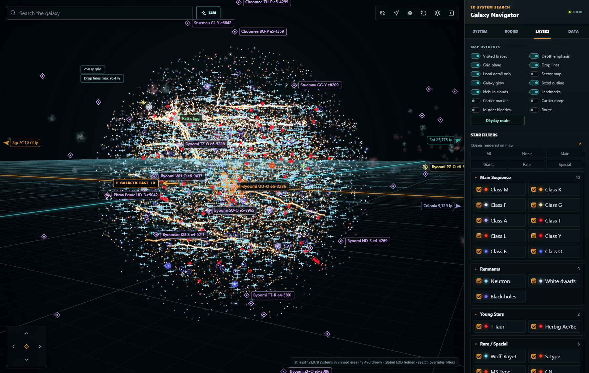
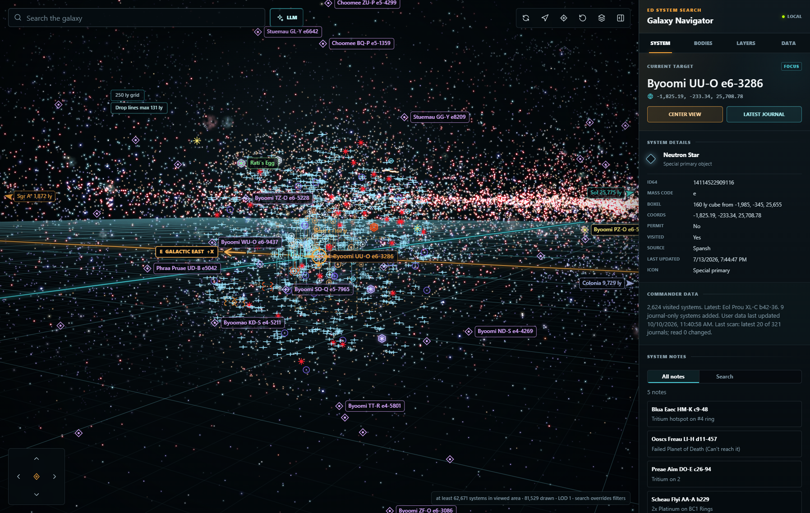

# Elite Dangerous System Search

A local desktop web application for exploring the Elite Dangerous galaxy. It
turns Spansh system dumps into compact local indexes, renders the galaxy as an
interactive 3D map, and enriches it with player journals, full body and station
records, notes, points of interest, and exploration overlays.

The application runs entirely on your computer. Generated databases, journal
history, and notes stay under `data/` and are excluded from Git.

## Interface

The map starts with nearby, full-resolution systems so the current area is
usable while the sampled whole-galaxy layer loads in the background. The Layers
tab includes **Local detail only**, which intentionally keeps that clearer local
view by hiding the global LOD layer. It is useful when dense local exploration
patterns are more useful than galaxy-wide context, and the preference persists
between sessions.

| Local detail only | Full galaxy detail |
| --- | --- |
|  |  |
| Detailed systems near the current view, with the global LOD layer hidden. | Sampled galaxy-wide context, merged with the local detailed sphere. |

## Highlights

- Interactive 3D galaxy map with orbit, pan, vertical movement, rotation,
  adaptive grids, distance guides, focus controls, and landmark bearings.
- Full-resolution local spatial detail merged with the sampled global LOD,
  loaded first so the current area is responsive while galaxy-wide context
  arrives in the background.
- Mass-layered galaxy LODs: like the in-game map, wide views favour heavy
  systems (O and B stars, Wolf-Rayet stars, black holes) using the mass code
  in each system's ID64, over a glow drawn from known-system density.
- Galaxy-map styling borrowed from the in-game map: stalks ending in flat
  footprint discs, coordinate labels lying on the grid plane, a focus ellipse,
  eased camera glides between targets, soft nebula clouds, and a route strip
  (current system, next jump, jumps left, destination).
- **Colour stars by** economy, security, or government, with a legend whose
  toggles drive the matching System features filter; visited braces stay on
  top of any colour mode.
- Persistent **Local detail only** mode to hide the global LOD layer and retain
  the clear, exploration-pattern-focused nearby view on purpose.
- Fast fuzzy system search with suggestions and filter-overriding results.
- Star colors and sprites based on primary-star class, including distinct
  treatment for black holes, neutron stars, white dwarfs, protostars, giants,
  and supergiants.
- Automatic star-marker scaling from a clear local view to an uncluttered
  whole-galaxy view, plus a manual scale control.
- Optional grid-relative depth emphasis that brightens grounded stars, fades
  off-plane context, strengthens drop-line footprints, and animates hovered
  depth guides.
- Persistent visited-system braces, latest-journal focus, carrier tracking, and
  incremental or full journal rescans.
- Current ship summary from journals, including a per-ship manual maximum-jump
  override that remains separate from the recorded Loadout value.
- Optional live route overlay from Elite's `NavRoute.json`, refreshed about
  every five seconds while the app is visible and resilient to temporary file
  writes.
- Journal-only systems and discovered body data are preserved even when the
  system is absent from the current Spansh dataset.
- Per-system notes with tooltip display, an all-notes view, and keyword search.
- EDAstro POIs and discovery overlays for nebulae, carriers, stellar features,
  stations, sightseeing locations, AA-A h sectors, rare valuable worlds, and
  Explorarium categories.
- Optional full-galaxy records for bodies, stations, economies, security,
  government, atmospheres, volcanism, rings, signals, and other system details.
- Rich map filters for stations, population, body counts, body types,
  atmospheres, ring materials, volcanism, economies, security, and government.
- Local keyword-planned search with optional configurable LLM planning and
  summaries (OpenAI, Kobold, or another compatible endpoint).
- Default-off **Murder Binaries** caution overlay for systems with a secondary
  star between 5 and 12 light-seconds from arrival.
- In-app controls for system deltas, full-data imports, places, discoveries,
  journals, and long-running update progress.

## Requirements

- Windows 11
- A current Node.js LTS release
- Stable Rust toolchain with `cargo`
- Substantial free disk space for Elite Dangerous dump data

The source tree is small, but generated datasets are not. A complete rich
galaxy installation can require hundreds of gigabytes. At least 32 GB of RAM is
recommended for large imports; more memory improves the native import path.

## Quick Start

### 1. Clone and build

```powershell
git clone <repository-url>
cd <repository-folder>
npm run native:build
```

This project currently uses only Node.js built-in modules, so there are no npm
packages to install. The Rust build creates the high-throughput importer used
for large system and galaxy dumps.

### 2. Import the base system map

Download `systems.json.gz` from [Spansh Dumps](https://spansh.co.uk/dumps) and
place it in the project root, then run:

```powershell
npm run import:systems
npm run import:updates
npm run import:name-lookup
npm run import:suggestions
npm run import:spatial-index
```

These commands create the compact binary map, update-time index, exact-name
lookup, search suggestions, and a 100 ly-cell spatial index under `data/`. The
spatial index lets close views merge full local system detail with the sampled
whole-galaxy LOD, and the same step writes the galaxy glow image
(`galaxy-density.bin`). The downloaded dump can be deleted after a successful import.

### 3. Add optional overlays

```powershell
npm run import:places
npm run import:discoveries
npm run import:journals
```

Journal files are detected from the standard Windows location:

```text
%USERPROFILE%\Saved Games\Frontier Developments\Elite Dangerous
```

Set `EDSS_JOURNAL_DIR` before starting or importing to use another location.
Set `EDSS_DATA_DIR` to store generated data outside the project.

### Optional local carrier tracking

Personal settings are kept outside the Git-tracked source. Copy
`config.example.json` to `config.local.json`, then fill in only the values you
want to use. The local file is ignored by Git.

The `trackedCarrier` settings enable carrier journal matching, the persistent
map landmark, and the optional 500 ly range bubble. `fallbackCoords` may be
left as `null`. You can also point to a configuration file elsewhere by setting
`EDSS_CONFIG` to its path before importing journals or starting the server.

### 4. Start the application

Double-click `Start ED System Search.bat`, or run:

```powershell
npm start
```

Open [http://localhost:5177](http://localhost:5177).

## Full Galaxy Details

The regular systems dump provides names, coordinates, primary-star classes, and
basic system metadata. Bodies, stations, factions, markets, and detailed
properties come from Spansh `galaxy.json.gz`.

After importing the base system map, place `galaxy.json.gz` in the project root
and run:

```powershell
npm run import:galaxy
```

Alternatively, stream the current dump directly:

```powershell
npm run import:galaxy:download
```

Rich records are stored separately under `data/galaxy/`, keeping ordinary map
navigation fast. See [Full Galaxy Data Storage](docs/GALAXY_DATA_STORAGE.md) for
the pack/index format, filtering sidecars, and delta behavior.

Once rich data is installed, build the Murder Binaries overlay with:

```powershell
npm run import:murder-binaries
```

The scanner reads the rich pack sequentially, performs minimal writes, and
creates a compact binary coordinate index plus a small metadata file. The map
queries only the nearest 50 warnings around the current view, so nearly a
million caution systems do not have to be sent to the browser. It does not
alter the rich database.

## Updating Data

The Data panel exposes the normal update workflows with progress and safeguards
for large downloads. Equivalent command-line updates are:

### Double-click updater

On Windows, double-click `Update ED System Search.cmd` in the project folder to
choose a system-map delta, rich-galaxy delta, journal refresh, or rebuild task.
It runs only the selected data-import command; it does **not** start the web
server. Choose **J** to import `galaxy.json.gz` already in the project folder,
or **K** to paste/drag any other local galaxy-dump path; neither option
downloads it again. Rich-data options build the native importer automatically
when needed. The full-galaxy download remains a separately confirmed choice
because it is a very large download.

After a completed full-galaxy import, option **N** performs a source-free,
dictionary-compression repack of the rich base pack. It does not download or
parse `galaxy.json.gz` again, but it is long-running and needs substantial
temporary disk space. The updater requires typing `REPACK` before it begins.

```powershell
npm run import:systems-delta:1day
npm run import:systems-delta:1week
npm run import:systems-delta:2weeks
npm run import:systems-delta:1month
npm run import:systems-delta:6months
npm run import:systems-delta:finish
```

To build the separate Green Gas Giant database from the installed full-galaxy
pack and the locally imported EDAstro POI list, run:

```powershell
npm run build:green-gas-giants
```

It writes `data/green-gas-giants.json`, retaining every known EDAstro GGG and
adding only strict very-high candidates: a Water Giant or Gas Giant with
Water-Based Life at 158 K. The resulting optional POI filters are `Green Gas
Giants` and `Green Gas Giant candidates`.

Rich-data deltas can be added without replacing the base pack:

```powershell
npm run import:galaxy-delta:1day
npm run import:galaxy-delta:7days
npm run import:galaxy-delta:1month
```

These commands also rebuild the map filter sidecars used by the System features
toggles. If you have already updated the normal system map and rich data, rebuild
only those sidecars with:

```powershell
npm run import:galaxy-filters
```

System-only updates preserve local journal systems and notes. Rich-data deltas
are searched newest-first when a system appears in multiple segments.

### Disk cleanup

The native importers, index builders, and server-managed JSON writers use temp
files that are renamed into place. If one of those operations is killed or
crashes it can strand `.tmp` files — a failed full-galaxy import can leave well
over 100 GB behind. The server clears these automatically at startup and after
each update, so no action is normally needed.

To run it by hand:

```powershell
npm run cleanup
```

Preview exactly what it would remove, without touching anything:

```powershell
npm run cleanup:dry-run
```

Cleanup only automatically removes `.tmp` files and directories under `data/`.
Live database files are never matched. Partial browser downloads
(`.crdownload`, `.part`, `.partial`, `.download`) in the project root are
reported but kept because they may be resumable. After confirming one is not
recoverable, opt in to removing aged partials with:

```powershell
node scripts/cleanup.js --include-partials
```

Cleanup is deferred while a known importer, index builder, or server-managed
atomic writer is active, and a temp file or directory is kept when it or any
descendant was modified within the last hour. Newly orphaned files are checked
again after that safety window.

Writers announce themselves with a lease file under `data/.active-imports`,
refreshed every 30 seconds while they run. Lease creation and destructive
cleanup also share `data/.cleanup-coordinator.lock`, so a writer cannot start in
the gap between cleanup's activity check and deletion. A stale lease is pruned
when its owner is no longer running. If a marker or coordinator lock's old PID
has been recycled by Windows, cleanup conservatively keeps treating it as
active; inspect the file and running process before manually removing it. There
is no portable way to distinguish a recycled PID from the original suspended
process using a PID alone, and retaining possibly active work is the safer
failure mode.

Downloaded source dumps such as `galaxy.json.gz` are **reported but kept**,
because re-downloading one is expensive. Delta updates stream directly from
Spansh and never write a dump to disk, so these only exist if you downloaded one
manually. Once the import has finished, the dump is no longer read by the app
and can be removed with:

```powershell
node scripts/cleanup.js --include-dumps
```

Note that `.git` can also grow unexpectedly if a large file is ever staged with
`git add` without being committed; `git gc --prune=now` reclaims that space.

## Map Controls

| Input | Action |
| --- | --- |
| Left drag | Orbit around the current target |
| Right drag | Move the orbit point across the X/Z plane |
| Ctrl + right drag | Move the orbit point along the Y axis |
| Mouse wheel | Zoom |
| `W` / `S` | Move forward / backward |
| `A` / `D` | Move left / right |
| `R` / `F` | Move up / down |
| `Q` / `E` | Rotate counterclockwise / clockwise |

Keyboard movement is suspended while typing in search or another text control.
The rendered X axis is mirrored to align more closely with the in-game galaxy
map; stored and displayed coordinates are not modified.

## Data Sources

- [Spansh Dumps](https://spansh.co.uk/dumps): systems and full galaxy records
- [EDAstro Map Files](https://edastro.com/mapcharts/files.html): POIs and
  exploration overlays
- [Explorarium](https://github.com/CMDRRegza/Explorarium): public discovery
  categories
- Local Elite Dangerous player journal files

Third-party data remains subject to its source's terms and attribution
requirements. Explorarium data used with permission.
Elite Dangerous is a trademark of Frontier Developments plc.
This project is an unofficial community tool and is not affiliated with or
endorsed by Frontier Developments, EDAstro, Spansh, or Explorarium.
